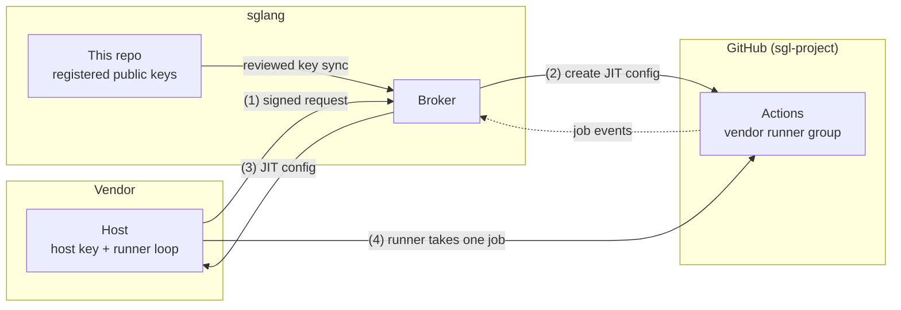

# Design overview

Vendor hosts run sglang CI jobs as one-shot GitHub Actions runners issued by a
central sglang service, the **broker**. A host never holds a GitHub credential:
it holds one key pair, and that key can only get runners for its own vendor,
host name and labels.

For setting up a host, see the [README](../README.md).

## Why a broker

The GitHub permission that registers self-hosted runners applies to the whole
organization; it cannot be limited to one runner group. Whoever holds it could
register runners into any group with any labels, edit groups, or remove anyone's
runners.

So that credential stays inside the broker, and no vendor gets it. Each vendor
host proves who it is with its own key, and the broker hands back a
just-in-time (JIT) runner config: it registers one runner, in that vendor's
group only, which runs one job and is then removed.

- **Your hosts hold no GitHub token.** A leaked host key gets runners for that
  one host, with its own labels and limits, until sglang revokes it.
- **Nothing in a request can widen access.** The runner group, the labels a key
  may use, its host name and its limits come from sglang's reviewed config,
  never from the request.
- **One runner per job.** A JIT config registers one runner, which takes one
  job and is gone.

## How it fits together

| Who | Holds | Can do |
|---|---|---|
| Vendor host | its own private key | ask the broker for a runner for that host, with that key's labels and limits |
| Broker | the GitHub App credential, which never leaves it | register runners in vendor groups; remove runners it issued that never came online |
| GitHub | the runner groups | send each job to a runner with matching labels, in a group the repository may use |

The broker sees only public keys, never a private key. A host never sees a
GitHub token.

## One job, start to finish

1. The runner loop on the host signs a token with the host's private key. It is
   valid for 60 seconds and works once.
2. The host sends it to the broker with its host name and one label.
3. The broker checks that the key is registered, not expired and not revoked;
   that the vendor, host name and label are ones this key may use; that the
   request comes from an allowed IP, if the vendor has an allowlist; and that
   the key and the vendor are within their rate and runner limits.
4. The broker asks GitHub for a JIT config for one runner in the vendor's group,
   records that it issued it, and returns the config.
5. The host starts the GitHub Actions runner with that config in a fresh
   environment. GitHub gives it one queued job with a matching label.
6. The job ends, the runner deregisters, and the host discards the environment.
   The loop asks again.

A runner that never comes online is removed within about 25 minutes, so it
stops counting against the limits. sglang also checks GitHub's job events and
runner list against what the broker issued, and follows up on anything that
doesn't match.

## Host keys

Each host has its own Ed25519 key pair, generated on the host. Its id, the
**kid**, is `<vendor>-<host>-<yyyy>-<mm>`, and it fixes three things:

- the **vendor**, and so the runner group and the labels the key may use;
- the **host name** the key may register runners for;
- the **month** the key was made: it stops working 13 months later.

A key reaches the broker only through two reviewed changes: a PR adding the
`.pub` file here, opened by one of the vendor's listed submitters, then a sync
into the broker's config. sglang can narrow a single key (fewer labels, fewer
runners, an earlier expiry) but nothing widens one.

Revoking a key takes effect within minutes, without waiting for a PR. A revoked
kid never works again; a replacement key gets a new kid.

## What runs on your side

How you run the runners is up to you (systemd, Kubernetes, Slurm, a scheduler of
your own), as long as job code can never reach the private key, every job runs
in a fresh, isolated environment, and failed requests back off with jitter. The
[README](../README.md#rules-for-your-setup) spells these out and describes the
two setups `client/runner_loop.sh` implements.

Hosts that scale up and down can ask the broker how many of their jobs are
waiting, per label, and size the pool from that
([Checking the queue](../README.md#checking-the-queue)).
